# Rangkuman Aplikasi SIMKEU Kecamatan Candisari 2027

> Dokumen ini merangkum cara kerja aplikasi **SIMKEU** (Sistem Manajemen Keuangan) berbasis Streamlit yang menggunakan Google Sheets sebagai basis data.
> Disusun dari pembacaan langsung kode sumber pada commit `9f8187b` (28 Oktober 2026).
>
> Isi: input yang dipakai → proses kerja per peran → output yang dihasilkan → temuan/keterbatasan.

---

## Daftar Isi

1. [Ringkasan Aplikasi](#1-ringkasan-aplikasi)
2. [Arsitektur dan Peta File](#2-arsitektur-dan-peta-file)
3. [Input dari Pengguna (Form)](#3-input-dari-pengguna-form)
4. [Input dari Spreadsheet (Master Data)](#4-input-dari-spreadsheet-master-data)
5. [Input Konfigurasi Environment](#5-input-konfigurasi-environment)
6. [Proses Kerja per Peran](#6-proses-kerja-per-peran)
7. [Alur Status dan Audit](#7-alur-status-dan-audit)
8. [Output yang Dihasilkan](#8-output-yang-dihasilkan)
9. [Matriks Hak Akses](#9-matriks-hak-akses)
10. [Temuan dan Keterbatasan](#10-temuan-dan-keterbatasan)
11. [Cara Menjalankan](#11-cara-menjalankan)

> **Dokumen ini memuat 13 diagram Mermaid:** komponen & deployment, siklus cache, urutan login, urutan simpan transaksi, relasi antar worksheet, urutan approval, urutan perubahan pagu, alur per peran, peta navigasi, state transaksi, state perubahan pagu, dan alur output dokumen.

---

## 1. Ringkasan Aplikasi

| Aspek | Keterangan |
|---|---|
| Nama | SIMKEU Kecamatan Candisari 2027 |
| Jenis | Aplikasi manajemen keuangan kecamatan (pagu, realisasi, approval, SPJ) |
| Framework | Streamlit `>=1.60,<2.0` dengan `st.navigation` multi-halaman |
| Bahasa | Python |
| Basis data | Google Sheets — spreadsheet **DATABASE SIMKEU KECAMATAN CANDISARI 2027** |
| Koneksi | `st.connection("gsheets", type=GSheetsConnection)` + service account |
| Library utama | `pandas`, `st-gsheets-connection`, `gspread`, `google-auth`, `openpyxl`, `reportlab`, `requests` |
| Notifikasi | Telegram Bot API (opsional, toggle tersimpan persisten di `.streamlit/app_settings.json`) |
| Autentikasi | Username + password dari worksheet `PENGGUNA`, disimpan di `st.session_state` |
| Peran | `ADMIN`, `KASUBAG_PEK`, `PPTK` |
| State form | Widget key dihapus dari `st.session_state` sebelum `st.rerun()` agar form kembali ke default setelah setiap aksi sukses |

Aplikasi dipakai untuk:

- Mencatat pengajuan transaksi belanja per sub kegiatan dan kode rekening.
- Memantau pagu, realisasi, dan sisa pagu.
- Melakukan approval (setujui/tolak), edit, hapus, dan cetak SPJ.
- Mengajukan perubahan pagu.
- Mengelola master data (wilayah, sub kegiatan, rekening, pengguna).
- Menelusuri riwayat perubahan lewat audit log.
- Mengunduh laporan Excel/PDF dan menerima notifikasi Telegram.

---

## 2. Arsitektur dan Peta File

```
streamlit_app.py            Entrypoint: page config, state login, st.navigation
db.py                       Koneksi Google Sheets + SPREADSHEET_URL
app_pages/
  login.py                  Form masuk (baca sheet PENGGUNA), st.spinner saat memuat pengguna
  logout.py                 Hapus session login
  transaksi.py              Form input transaksi + daftar/filter transaksi, export di sidebar
  dashboard.py              KPI, grafik (expander), perbandingan, transaksi terbaru, export, toggle Telegram
  manajerial.py             Analisis per PPTK, alert pagu, approval, SPJ, peringkat
  perubahan_pagu.py         Form pengajuan perubahan pagu + daftar
  master_data.py            CRUD master + audit log (5 tab)
  helpers.py                Backend bersama: baca/tulis sheet, format, export, audit, reset_form_keys, get_ajukan_ulang_map, load/save_telegram_setting
tests/test_app.py           AppTest + unit test fungsi murni
.streamlit/app_settings.json Setting Telegram persistente (telegram_enabled)
SPECS_SPREADSHEET.md        Spesifikasi kolom worksheet
```

### 2.1 Alur teknis umum

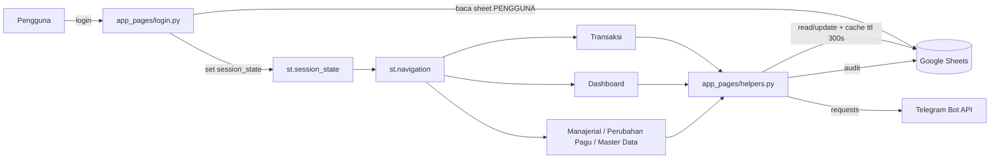

### 2.2 Lapisan data

| Fungsi di `helpers.py` | Peran |
|---|---|
| `load_sheet(nama)` | Membaca worksheet, di-cache `@st.cache_data(ttl=300)`, mengembalikan `DataFrame` kosong bila gagal |
| `update_sheet_data(nama, df)` | Menulis ulang **seluruh** worksheet lalu `load_sheet.clear()` |
| `write_audit_log(...)` | Menambah baris ke `AUDIT_LOG` |
| `append_transaksi`, `edit_transaksi`, `delete_transaksi`, `update_transaksi_status` | Operasi transaksi + audit |
| `add/edit/delete_master_*` | Operasi master data + audit |
| `parse_number`, `to_number_series`, `format_rupiah`, `format_df_rupiah` | Normalisasi angka dan format Rupiah |
| `export_to_excel`, `export_to_pdf`, `generate_spj_document` | Pembuatan berkas unduhan |
| `get_subkegiatan_full`, `get_rekening_full` | Label dropdown `kode - nama` |
| `is_manager(peran)` | Cek peran `ADMIN` / `KASUBAG_PEK` |
| `send_telegram(pesan)` | Kirim notifikasi bila `st.secrets["telegram"]` tersedia; cek `telegram_enabled` dari `st.session_state` (fallback ke file JSON) |
| `reset_form_keys(*keys)` | Hapus key widget dari `st.session_state` agar form kembali ke default setelah aksi sukses |
| `get_ajukan_ulang_map()` | Baca `AUDIT_LOG`, kembalikan peta `{NO baru: NO lama}` untuk deteksi transaksi yang sudah diajukan ulang (retroaktif) |
| `load_telegram_setting()` / `save_telegram_setting(val)` | Baca/tulis setting `telegram_enabled` ke `.streamlit/app_settings.json` agar tidak hilang saat restart server |

Catatan teknis:

- Cache data 300 detik pada `load_sheet`; koneksi `conn.read(..., ttl=30)`.
- Setiap penyimpanan menulis ulang seluruh worksheet (bukan append baris).
- `SPREADSHEET_URL` ditulis langsung di `db.py`.

### 2.3 Diagram komponen dan deployment

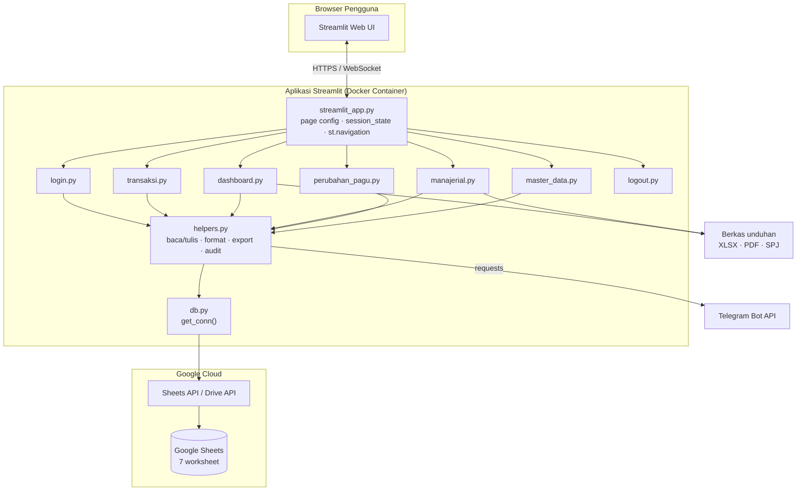

Keterangan:

- Semua halaman memakai `helpers.py` sebagai satu-satunya lapisan akses data.
- `db.py` hanya membuat koneksi; tidak menyimpan state halaman.
- Telegram dipanggil dari alur simpan transaksi (`transaksi.py` → `helpers.send_telegram`).
- PDF/Excel dibuat di memori (`BytesIO`) lalu dikirim sebagai `st.download_button`.

### 2.4 Siklus cache dan konsistensi data

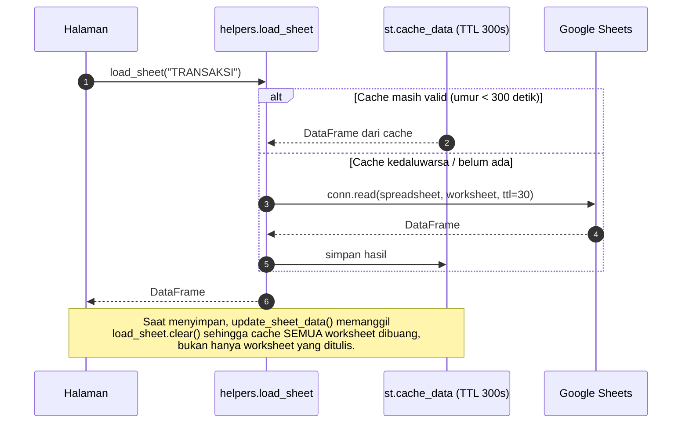

Implikasi:

| Kondisi | Efek |
|---|---|
| Data diubah dari luar aplikasi (manual di Sheets) | Baru terlihat setelah cache 300 detik kedaluwarsa |
| Aplikasi menyimpan data | Seluruh cache `load_sheet` dibuang, semua halaman membaca ulang |
| Dua pengguna menyimpan bersamaan | Update terakhir menang; perubahan pertama bisa tertimpa |
| `AUDIT_LOG` ditulis | Ikut memicu pembacaan ulang penuh saat cache dibersihkan |

---

## 3. Input dari Pengguna (Form)

### 3.1 Login — `app_pages/login.py`

| Field | Tipe | Aturan |
|---|---|---|
| `User Name` | text | Di-`strip()` dan di-`lower()`; wajib; maks. 100 karakter |
| `Password` | password | Di-`strip()`; wajib; maks. 100 karakter |

Proses:

1. Baca worksheet `PENGGUNA` (cache 300 detik) dibungkus `st.spinner("Memuat data pengguna…")` untuk menyembunyikan pesan internal GSheetsServiceAccountClient.
2. Cocokkan `User Name` case-insensitive.
3. Bandingkan password dengan `secrets.compare_digest`.
4. Jika cocok → isi `session_state.current_user`, `logged_in = True`.
5. Jika peran `PPTK` → set `pptk_filter = "Nama (User Name)"`; selain itu `"Semua PPTK"`.
6. `st.rerun()` untuk memuat navigasi sesuai peran.

Pesan gagal: field kosong, input terlalu panjang, sheet tidak terbaca, sheet kosong, kolom tidak lengkap, username tidak ditemukan, atau password salah.

#### Diagram urutan login

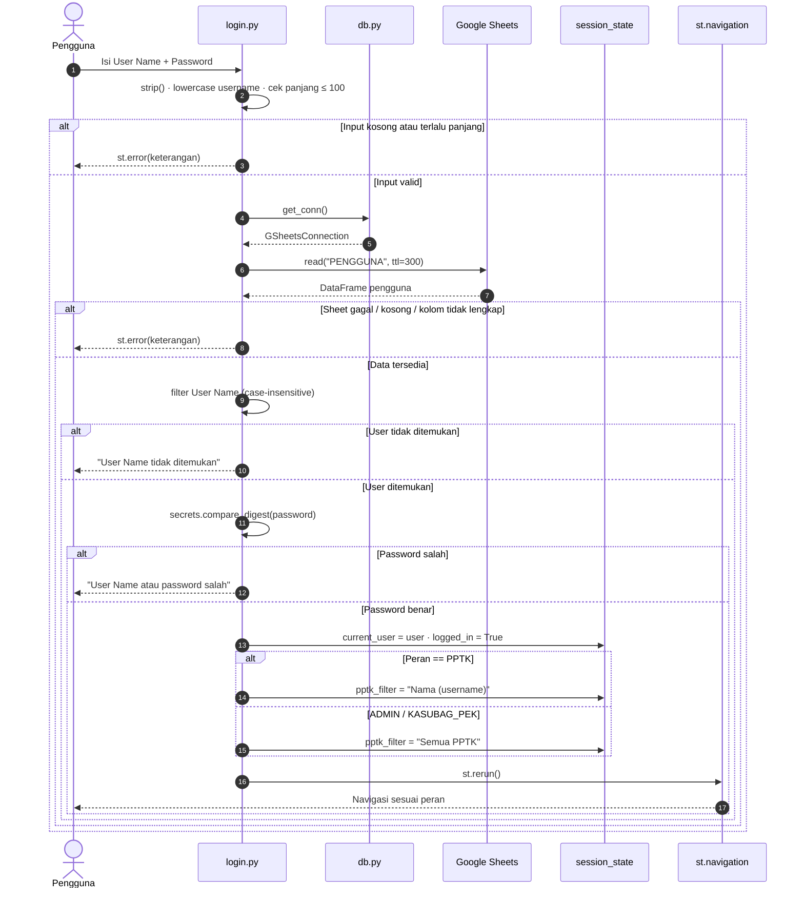

### 3.2 Input Transaksi — `app_pages/transaksi.py`

| Field | Widget | Wajib | Nilai / Validasi |
|---|---|---|---|
| `Tanggal Pengajuan` | `date_input` | Ya | Default hari ini; disimpan `DD/MM/YYYY` |
| `Sub Kegiatan` | `selectbox` | Ya | Opsi dari `MASTER_SUB_KEGIATAN`, label `kode - nama` |
| `Kode Rekening Belanja` | `selectbox` | Ya | Opsi dari `MASTER_REKENING`, label `kode — uraian` |
| `Pengelompokan Belanja (#)` | `text_input` | Tidak | Teks bebas |
| `Jenis Transaksi` | `selectbox` | Ya | `UP/GU` atau `LS` |
| `Nominal (Rp)` | `number_input` | Ya | `min_value=0`, `step=1000`; harus > 0 |
| `Uraian` | `text_area` | Tidak | Teks bebas |
| `Bukti Dukung SPJ` | `text_input` | Tidak | Tautan atau nomor bukti |

Validasi: `Sub Kegiatan`, `Kode Rekening`, dan `Nominal` harus benar (`nominal > 0`, opsi bukan `"-"`).

Saat disimpan, aplikasi mengisi otomatis:

| Kolom | Nilai |
|---|---|
| `NO` | `max(NO) + 1` |
| `STATUS` | `Draft` |
| `PPTK` | `"{Nama} ({User Name})"` dari user login |
| `TANGGAL PENGAJUAN` | Tanggal form, format `DD/MM/YYYY` |

Setelah tersimpan: audit `CREATE` + notifikasi Telegram berisi nomor, PPTK, sub kegiatan, rekening, jenis, nominal, tanggal, dan uraian.
- Semua widget form (`tx_tanggal`, `tx_subkegiatan`, `tx_rekening`, `tx_pengelompokan`, `tx_jenis`, `tx_nominal`, `tx_uraian`, `tx_bukti`) direset ke state awal sebelum `st.rerun()`.

#### Diagram urutan simpan transaksi

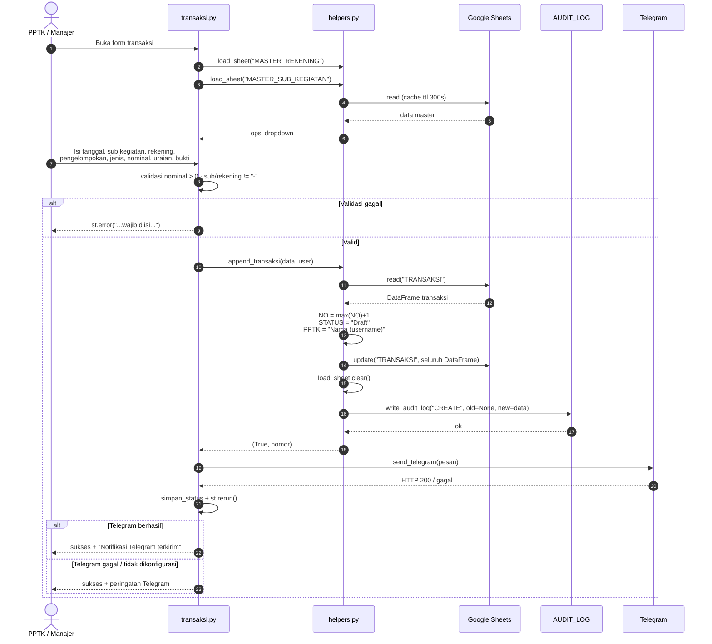

### 3.3 Filter dan Pencarian Transaksi

| Filter | Perilaku |
|---|---|
| Tanggal | `contains` teks pada `TANGGAL PENGAJUAN` (contoh `01/01/2027`) |
| Sub Kegiatan | `contains` case-insensitive |
| Kode Rekening | `contains` case-insensitive |
| Status | `Semua`, `Draft`, `Diajuan`, `Disetujui`, `Ditolak` |
| PPTK | Otomatis dari `pptk_filter` (hanya menyaring untuk peran PPTK) |

### 3.4 Input Perubahan Pagu — DINONAKTIFKAN

Fitur pengajuan perubahan pagu oleh PPTK melalui `app_pages/perubahan_pagu.py` telah dinonaktifkan. Perubahan pagu hanya dapat dilakukan langsung oleh `KASUBAG_PEK` di halaman Manajerial (section "Perubahan Pagu"). Halaman `perubahan_pagu.py` menampilkan pesan "tidak tersedia" untuk semua role.

### 3.5 Input Master Data — `app_pages/master_data.py`

| Tab | Form yang tersedia | Field |
|---|---|---|
| Wilayah | Tambah | `Nama Wilayah`, `Kode Wilayah` |
| Sub Kegiatan | Tambah | `Kode Sub Kegiatan`, `Nama Kegiatan`, `Pagu Awal (Rp)` |
| Rekening | Tambah; Edit/Hapus | Tambah: `Kode Rekening`, `Uraian Rekening`. Edit/Hapus: `Indeks Baris`, kode & uraian baru |
| Pengguna | Tambah | `User Name`, `Password`, `Nama Lengkap`, `Peran` (`ADMIN`/`KASUBAG_PEK`/`PPTK`) |
| Audit Log | Lihat + Refresh | — |

Catatan: edit/hapus berbasis **indeks baris** (0-based) pada sheet, bukan ID yang terlihat di UI.

---

## 4. Input dari Spreadsheet (Master Data)

Spreadsheet: **DATABASE SIMKEU KECAMATAN CANDISARI 2027**. Nama worksheet dan header **case-sensitive**.

### 4.1 Ringkasan worksheet

| Worksheet | Diisi oleh | Fungsi |
|---|---|---|
| `PENGGUNA` | Admin (manual/UI) | Login dan peran |
| `MASTER_WILAYAH` | Admin (UI) | Data wilayah |
| `MASTER_REKENING` | Admin (UI) | Dropdown kode rekening |
| `MASTER_SUB_KEGIATAN` | Admin (UI) | Dropdown sub kegiatan + pagu |
| `TRANSAKSI` | Aplikasi (form) | Data transaksi |
| `PERUBAHAN_PAGU` | Aplikasi (form) | Riwayat pengajuan pagu |
| `AUDIT_LOG` | Aplikasi (otomatis) | Riwayat perubahan |

#### Diagram relasi antar worksheet

Relasi bersifat **logis** (bukan foreign key database), karena semua data berada di Google Sheets dan dihubungkan lewat kode/nama.

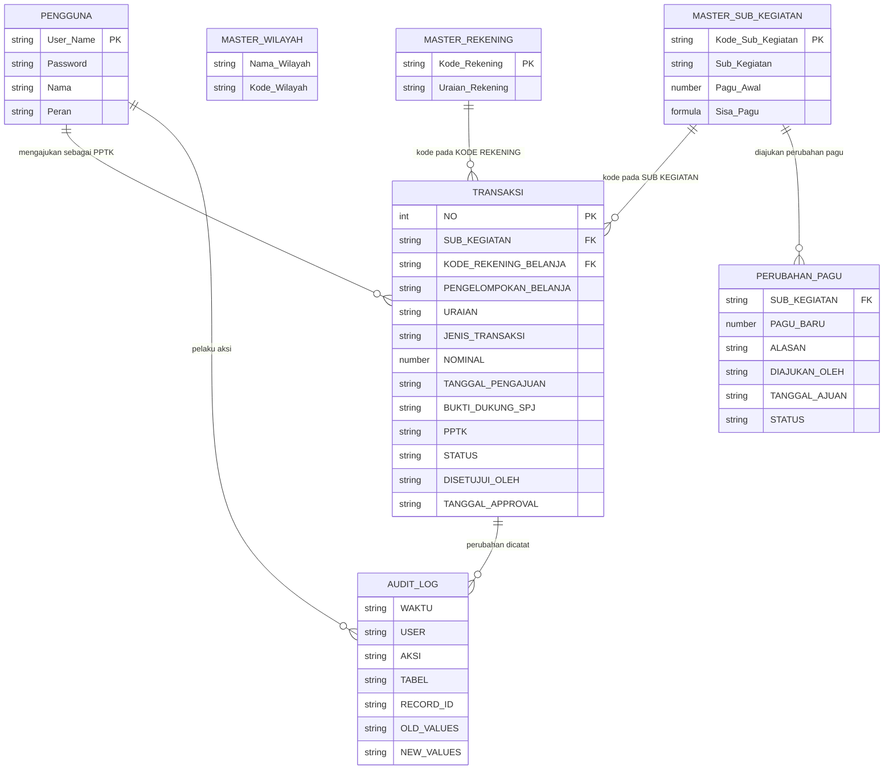

Catatan relasi:

| Relasi | Kunci penghubung | Risiko |
|---|---|---|
| `TRANSAKSI` → `MASTER_SUB_KEGIATAN` | `SUB KEGIATAN` berformat `"kode - nama"`, diambil kode sebelum `" - "` | Jika nama sub kegiatan berubah, baris lama menyimpan nama lama |
| `TRANSAKSI` → `MASTER_REKENING` | `KODE REKENING BELANJA` | Rekening dihapus → transaksi lama kehilangan referensi |
| `TRANSAKSI` → `PENGGUNA` | `PPTK` berformat `"Nama (username)"` | Ganti nama user → filter PPTK lama tidak cocok |
| `PERUBAHAN_PAGU` → `MASTER_SUB_KEGIATAN` | `SUB KEGIATAN` berisi kode saja | Tidak ada validasi kode harus ada |
| `AUDIT_LOG` → semua tabel | `TABEL` + `RECORD_ID` (teks bebas) | Tidak bisa di-join otomatis, hanya untuk penelusuran manual |

### 4.2 `PENGGUNA`

| Kolom | Tipe | Wajib | Contoh |
|---|---|---|---|
| `User Name` | Text | Ya | `admin` |
| `Password` | Text | Ya | `admin123` (plaintext) |
| `Nama` | Text | Ya | `Budi Santoso` |
| `Peran` | Text | Ya | `ADMIN`, `KASUBAG_PEK`, `PPTK` |

### 4.3 `MASTER_WILAYAH`

| Kolom | Tipe | Wajib | Contoh |
|---|---|---|---|
| `Nama Wilayah` | Text | Ya | `Kecamatan Candisari` |
| `Kode Wilayah` | Text | Ya | `KC01` |

### 4.4 `MASTER_REKENING`

| Kolom | Tipe | Wajib | Contoh |
|---|---|---|---|
| `Kode Rekening` | Text | Ya | `5.2.1.01` |
| `Uraian Rekening` | Text | Ya | `Honorarium PPTK` |

### 4.5 `MASTER_SUB_KEGIATAN`

| Kolom | Tipe | Wajib | Contoh |
|---|---|---|---|
| `Kode Sub Kegiatan` | Text | Ya | `SK001` |
| `Sub Kegiatan` | Text | Ya | `Pembinaan Keuangan Desa` |
| `Pagu Awal` | Angka | Ya | `50000000` |
| `Sisa Pagu` | Formula | Ya | `=C2 - SUMIFS(TRANSAKSI!G:G, TRANSAKSI!B:B, A2 & "*", TRANSAKSI!K:K, "Disetujui")` |

Formula `Sisa Pagu` ditulis ulang otomatis setiap kali sub kegiatan ditambah/diubah/dihapus agar tidak berubah menjadi nilai statis.

### 4.6 `TRANSAKSI`

| Kolom | Tipe | Wajib | Diisi | Contoh |
|---|---|---|---|---|
| `NO` | Angka | Ya | Aplikasi | `1` |
| `SUB KEGIATAN` | Text | Ya | Aplikasi | `SK001 - Pembinaan Keuangan Desa` |
| `KODE REKENING BELANJA` | Text | Ya | Form | `5.2.1.01` |
| `PENGELOMPOKAN BELANJA (#)` | Text | Tidak | Form | `Bahan Konsumsi` |
| `URAIAN` | Text | Tidak* | Form | `Honorarium bulanan PPTK` |
| `JENIS TRANSAKSI (UP/GU/LS)` | Text | Ya | Form | `UP/GU` |
| `NOMINAL` | Angka | Ya | Form | `2500000` |
| `TANGGAL PENGAJUAN` | Text | Ya | Form | `01/01/2027` |
| `BUKTI DUKUNG SPJ` | Text | Tidak | Form | `SPJ-001/2027` |
| `PPTK` | Text | Ya | Aplikasi | `Agus Setiawan (pptk1)` |
| `STATUS` | Text | Ya | Aplikasi | `Draft` |
| `DISETUJUI_OLEH` | Text | Tidak | Aplikasi | `Budi Santoso` |
| `TANGGAL_APPROVAL` | Text | Tidak | Aplikasi | `02/01/2027` |
| `ALASAN_PENOLAKAN` | Text | Tidak | Aplikasi | `-` |

\* `URAIAN` tidak divalidasi wajib oleh form, meskipun spec menyebut wajib.

### 4.7 `PERUBAHAN_PAGU`

| Kolom | Tipe | Wajib | Contoh |
|---|---|---|---|
| `SUB KEGIATAN` | Text | Ya | `SK001` |
| `PAGU BARU` | Angka | Ya | `60000000` |
| `ALASAN` | Text | Tidak | `Penambahan dana dari pemda` |
| `DIAJUKAN OLEH` | Text | Ya | `Budi Santoso` |
| `TANGGAL AJUAN` | Text | Ya | `05/01/2027` |
| `STATUS` | Text | Ya | `Menunggu Approval` |

### 4.8 `AUDIT_LOG`

| Kolom | Isi |
|---|---|
| `WAKTU` | `DD/MM/YYYY HH:MM:SS` |
| `USER` | Nama pelaku (atau `Sistem`) |
| `AKSI` | `CREATE`, `UPDATE`, `DELETE`, `UPDATE_STATUS` |
| `TABEL` | Nama worksheet |
| `RECORD_ID` | Nomor transaksi / kode / indeks baris |
| `OLD VALUES` | `str(dict)` nilai lama |
| `NEW VALUES` | `str(dict)` nilai baru |

---

## 5. Input Konfigurasi Environment

File `.streamlit/secrets.toml` (contoh di `secrets.toml.example`):

| Bagian | Key | Fungsi |
|---|---|---|
| `[connections.gsheets]` | `spreadsheet`, service-account fields | Kredensial Google Sheets |
| `[telegram]` | `bot_token`, `chat_id` | Notifikasi transaksi baru (opsional) |
| `[users]` | pasangan `user = "password"` | Contoh/legacy; **tidak dibaca** oleh kode login saat ini |

Konfigurasi lain:

| Lokasi | Isi |
|---|---|
| `db.py` | `SPREADSHEET_URL` (diambil dari `st.secrets`, fallback ke URL lama) |
| `.streamlit/app_settings.json` | Setting `telegram_enabled` (persisten, tidak hilang saat restart server) |
| `requirements.txt` | Dependensi Python |
| `.streamlit/config.toml` | Tema/konfigurasi Streamlit (bila ada) |
| `Dockerfile`, `docker-compose.yml` | Deployment container, healthcheck `/_stcore/health` |

---

## 6. Proses Kerja per Peran

### 6.1 Peran `PPTK` (Pengguna Teknis Kegiatan)

**Menu yang terlihat:** Transaksi, Dashboard, Keluar.

**Alur:**

1. Login → sistem otomatis menetapkan `pptk_filter = "Nama (username)"`.
2. **Transaksi** → isi form → simpan.
   - `NO` otomatis, `STATUS = Draft`, `PPTK` otomatis dari akun.
   - Audit `CREATE` tercatat; notifikasi Telegram dikirim bila dikonfigurasi.
3. **Daftar transaksi** → hanya baris dengan `PPTK` sama dengan filter miliknya.
4. **Dashboard** → KPI, grafik, dan tabel hanya memakai transaksi miliknya.
   - Daftar sub kegiatan juga dipersempit ke sub kegiatan yang pernah ia transaksikan.
5. **Export** → hanya tombol **Unduh Excel** di sidebar (muncul saat menu Transaksi aktif); tombol PDF tidak muncul (ada keterangan "khusus manajer").
6. Tidak bisa membuka Manajerial, Pengajuan Pagu, atau Master Data (tidak ada di navigasi; halaman juga menolak lewat guard `is_manager`).

**Yang tidak bisa dilakukan PPTK:** approval, cetak SPJ, ubah pagu, kelola master, unduh PDF.
**PPTK bisa:** edit uraian dan nominal transaksi `Draft` miliknya, hapus transaksi `Draft` miliknya, dan mengajukan ulang transaksi `Ditolak` miliknya (menjadi `Draft` baru dengan nomor baru).

### 6.2 Peran `ADMIN` dan `KASUBAG_PEK` (Manajer)

Kedua peran diperlakukan sama oleh `is_manager()`. Menu: Transaksi, Dashboard, Manajerial, Master Data, Keluar.

#### a. Transaksi

- Dapat menambah transaksi (atas nama dirinya sendiri sebagai `PPTK`).
- Melihat **seluruh** transaksi (tanpa filter PPTK otomatis).
- Filter tanggal/sub kegiatan/rekening/status tersedia.

#### b. Dashboard

- KPI: jumlah sub kegiatan, total pagu, realisasi, sisa pagu, dan persentase terpakai.
- Grafik batang realisasi per sub kegiatan.
- Grafik garis tren realisasi per bulan.
- Tabel **Perbandingan Target vs Realisasi per Sub Kegiatan** (khusus manajer).
- Tabel transaksi terbaru.
- Sidebar export: **Excel** dan **PDF**.
- Sidebar **Notifikasi Telegram** (toggle, hanya manajer): pengaturan tersimpan persisten di `.streamlit/app_settings.json`, tidak kembali ke default setelah restart server. PPTK tidak melihat toggle ini sama sekali.

#### c. Manajerial

1. **Ringkasan realisasi per PPTK** — total nominal per nama PPTK, urut menurun.
2. **Peringatan pagu ≥90%** — sub kegiatan dengan `Realisasi / Pagu Awal ≥ 90%`.
3. **Antrian approval** — transaksi berstatus `Draft` atau `Menunggu Approval`.
   Aksi tersedia:
   | Aksi | Efek |
   |---|---|
   | Setujui | `STATUS = Disetujui`, isi `DISETUJUI_OLEH`, `TANGGAL_APPROVAL`; audit `UPDATE_STATUS` |
   | Tolak | `STATUS = Ditolak`, isi `DISETUJUI_OLEH`, `TANGGAL_APPROVAL` dan `ALASAN_PENOLAKAN` (wajib diisi); audit `UPDATE_STATUS`; notifikasi dikirim ke PPTK |
   | Cetak SPJ | Unduh `SPJ_No{no}.pdf` |
   | Edit / Hapus oleh manajer | **Dihapus** — PPTK sendiri yang mengedit atau menghapus transaksi `Draft` miliknya |
4. **Peringkat PPTK** — urutan berdasarkan total realisasi.

#### Diagram urutan approval dan aksi manajer

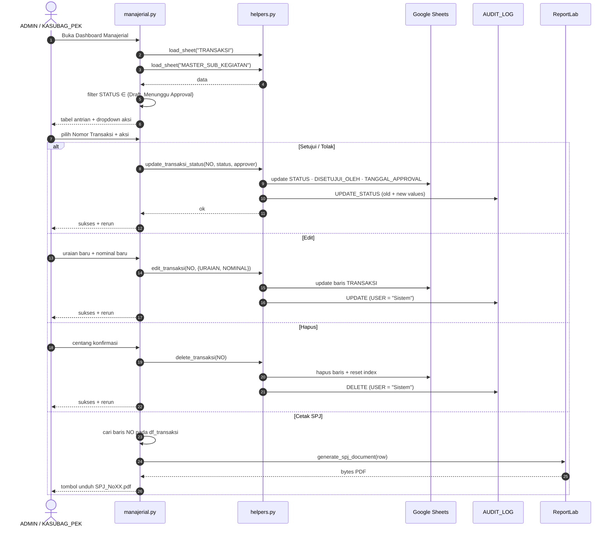

#### d. Perubahan Pagu (khusus KASUBAG_PEK)

- KASUBAG_PEK memilih sub kegiatan, input nominal perubahan (positif = penambahan, negatif = pengurangan), dan mencatatnya langsung ke kolom `Perubahan Pagu` di sheet `MASTER_SUB_KEGIATAN`.
- Sisa Pagu dihitung otomatis oleh formula di spreadsheet: `Pagu Akhir + Perubahan Pagu − Realisasi (Disetujui)`.
- Setiap perubahan dicatat di `AUDIT_LOG` (`UPDATE`, `MASTER_SUB_KEGIATAN`, user Kasubag).
- PPTK dan ADMIN tidak memiliki akses ke fitur ini.

#### e. Master Data

- Tambah wilayah, sub kegiatan, rekening, pengguna.
- Edit/hapus rekening berdasarkan indeks baris.
- Melihat audit log (urut waktu terbaru) dan tombol refresh.

#### f. Export

- **Excel** untuk semua user login.
- **PDF** hanya manajer.

### 6.3 Ringkasan alur per peran

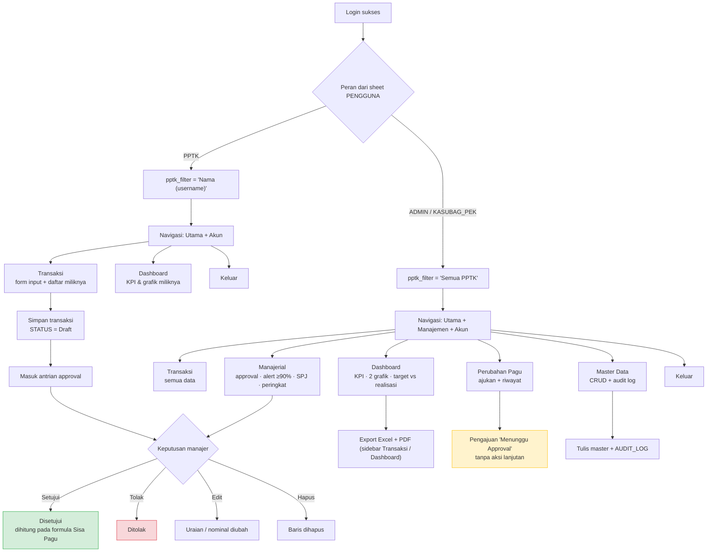

Toggle Telegram tersimpan persisten di `.streamlit/app_settings.json`; hanya muncul di sidebar Dashboard untuk role manajer (ADMIN/KASUBAG_PEK).

### 6.4 Peta navigasi (`st.navigation`)

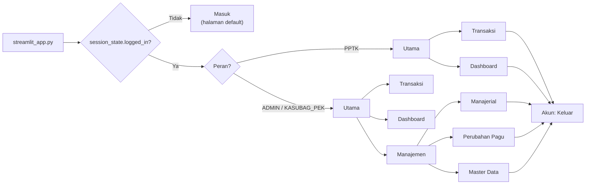

Guard tambahan: setiap halaman manajemen memanggil `helpers.is_manager()` dan `st.stop()` bila peran tidak sesuai, sehingga akses langsung lewat URL tetap ditolak.

---

## 7. Alur Status dan Audit

### 7.1 Status transaksi

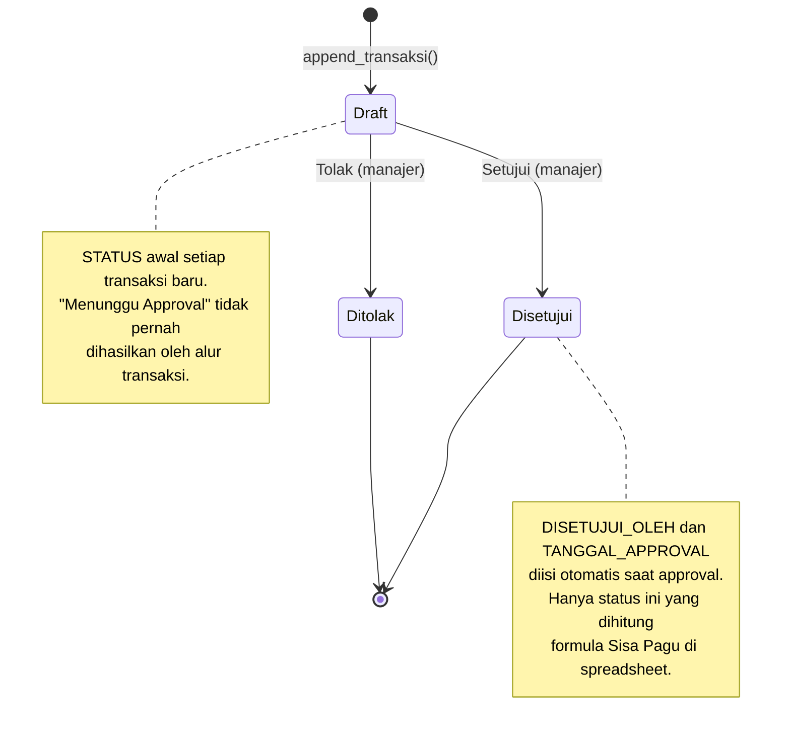

- Status awal selalu `Draft` (`append_transaksi`).
- `Menunggu Approval` ikut difilter sebagai antrian, tetapi **tidak pernah** ditulis oleh kode transaksi.
- Setiap perubahan status mengisi `DISETUJUI_OLEH` dan `TANGGAL_APPROVAL`.

### 7.2 Status perubahan pagu

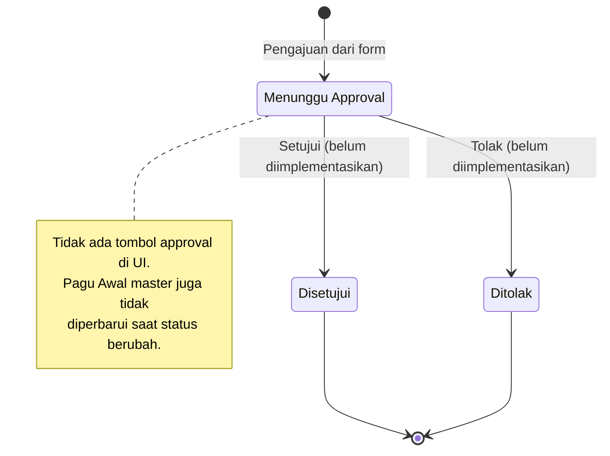

### 7.3 Audit log

| Operasi | AKSI | USER yang dicatat |
|---|---|---|
| Tambah transaksi | `CREATE` | Nama user login |
| Ubah status | `UPDATE_STATUS` | Nama approver |
| Edit transaksi | `UPDATE` | `"Sistem"` (bukan user login) |
| Hapus transaksi | `DELETE` | `"Sistem"` |
| Tambah/edit/hapus master | `CREATE` / `UPDATE` / `DELETE` | Nama user login |

Nilai lama dan baru disimpan sebagai string dictionary.

---

## 8. Output yang Dihasilkan

### 8.1 Output di layar

| Halaman | Output |
|---|---|
| Login | Form masuk, pesan error, spinner "Memuat data pengguna…" saat baca sheet |
| Transaksi | Konfirmasi simpan, form direset otomatis setelah sukses, tabel transaksi terfilter + jumlah tampil/total |
| Dashboard | 4 KPI (jumlah sub kegiatan, total pagu, realisasi, sisa pagu + % terpakai), bar chart per sub kegiatan (expander), line chart tren bulanan (expander), tabel target vs realisasi (manajer, expander), tabel transaksi terbaru |
| Manajerial | Tabel realisasi per PPTK, daftar alert pagu ≥90%, antrian approval + panel aksi, peringkat PPTK |
| Perubahan Pagu | Konfirmasi pengajuan, tabel riwayat perubahan pagu |
| Master Data | Tabel per tab, konfirmasi tambah/edit/hapus, audit log terurut |
| Sidebar Dashboard | Tombol unduh Excel; tombol unduh PDF untuk manajer; toggle Notifikasi Telegram (hanya manajer, tersimpan persisten) |
| Sidebar Transaksi | Tombol unduh Excel (data terfilter); tombol unduh PDF untuk manajer (hanya saat menu Transaksi aktif) |

Format angka: `Rp 1.000.000`, nilai negatif `(Rp 500.000)`, nilai tidak valid `-`.

### 8.2 Output dokumen (unduhan)

| Berkas | Siapa | Isi |
|---|---|---|
| `laporan_simkeu.xlsx` | Semua user login | Seluruh kolom transaksi yang sedang tampil (setelah filter PPTK) |
| `laporan_simkeu.pdf` | `ADMIN` / `KASUBAG_PEK` | 1) Ringkasan eksekutif (total pagu, realisasi, sisa, %), 2) Perbandingan target vs realisasi per sub kegiatan, 3) Daftar transaksi |
| `SPJ_No{nomor}.pdf` | Manajer | Surat Pertanggungjawaban per transaksi: no, tanggal, PPTK, sub kegiatan, rekening, pengelompokan, jenis, nominal, uraian, bukti dukung, status, kolom tanda tangan |

#### Diagram alur pembuatan output dokumen

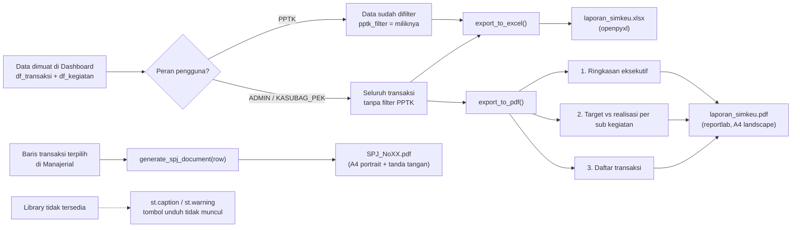

Catatan:

- `openpyxl` dan `reportlab` diimpor dengan `try/except`; jika gagal, tombol unduh diganti keterangan.
- Excel berisi data apa adanya (kolom mentah), sedangkan PDF memakai format Rupiah dan kolom terpilih.
- PDF laporan hanya dirender untuk manajer; PPTK melihat caption "Unduh PDF hanya untuk manajer".

### 8.3 Output ke basis data

| Aksi | Dampak |
|---|---|
| Simpan transaksi | Baris baru di `TRANSAKSI` + baris `AUDIT_LOG` |
| Approval | Update `STATUS`, `DISETUJUI_OLEH`, `TANGGAL_APPROVAL` + `AUDIT_LOG` |
| Edit/hapus transaksi | Update/hapus baris `TRANSAKSI` + `AUDIT_LOG` |
| Master data | Tambah/ubah/hapus baris master + `AUDIT_LOG`; `Sisa Pagu` ditulis ulang sebagai formula |
| Perubahan pagu | Update `Perubahan Pagu` di `MASTER_SUB_KEGIATAN` + `AUDIT_LOG` (`UPDATE`, user Kasubag) |

### 8.4 Output notifikasi

Pesan Telegram saat transaksi baru:

```
📌 Transaksi Baru SIMKEU
No: {nomor}
PPTK: {nama (username)}
Sub Kegiatan: {kode - nama}
Rekening: {kode}
Jenis: {UP/GU | LS}
Nominal: {Rp ...}
Tanggal: {DD/MM/YYYY}
Uraian: {uraian}
```

Bila `bot_token`/`chat_id` tidak ada atau gagal, transaksi tetap tersimpan dan UI menampilkan peringatan.

Setting notifikasi Telegram (`telegram_enabled`) disimpan persisten di `.streamlit/app_settings.json`:
- Default: `True` (aktif).
- Hanya role manajer (ADMIN/KASUBAG_PEK) yang dapat mengubah toggle di sidebar Dashboard.
- Nilai tersimpan ke file JSON saat toggle diubah, sehingga tidak kembali ke default setelah restart server.
- `send_telegram()` membaca nilai dari `st.session_state` (fallback ke file JSON), sehingga halaman lain selain Dashboard juga menghormati setting ini.

---

## 9. Matriks Hak Akses

| Kemampuan | PPTK | ADMIN | KASUBAG_PEK |
|---|:---:|:---:|:---:|
| Login | ✅ | ✅ | ✅ |
| Tambah transaksi | ✅ | ✅ | ✅ |
| Lihat transaksi | Milik sendiri | Semua | Semua |
| Filter & pencarian | ✅ | ✅ | ✅ |
| Dashboard KPI + grafik | ✅ (data sendiri) | ✅ | ✅ |
| Tabel target vs realisasi | ❌ | ✅ | ✅ |
| Manajerial | ❌ | ✅ | ✅ |
| Approve / tolak transaksi | ❌ | ✅ | ✅ |
| Edit / hapus transaksi | ❌ | ✅ | ✅ |
| Cetak SPJ | ❌ | ✅ | ✅ |
| Ajukan perubahan pagu | ❌ | ✅ | ✅ |
| Master data | ❌ | ✅ | ✅ |
| Audit log | ❌ | ✅ | ✅ |
| Export Excel | ✅ | ✅ | ✅ |
| Export PDF | ❌ | ✅ | ✅ |
| Notifikasi Telegram (penerima) | — | — | — |

---

## 10. Temuan dan Keterbatasan

Diurutkan dari yang paling berdampak pada akurasi/operasional.

### 10.1 Angka realisasi dashboard berpotensi berbeda dengan `Sisa Pagu` di sheet

- **Diperbaiki:** Dashboard, grafik, tren bulanan, target-vs-realisasi, peringatan ≥90%, dan peringkat PPTK sekarang hanya menjumlahkan transaksi `STATUS = "Disetujui"`, konsisten dengan formula `Sisa Pagu` di spreadsheet.
- Transaksi `Draft` dan `Ditolak` tidak lagi dihitung dalam realisasi.

### 10.2 Opsi filter status `"Diajuan"` (typo) dan status yang tidak pernah dipakai

- **Diperbaiki:** Opsi `"Diajuan` dihapus dari daftar filter status. Daftar sekarang: `["Semua", "Draft", "Disetujui", "Ditolak"]`.
- Antrian approval manajerial hanya menampilkan `Draft` (fitur pengajuan `PERUBAHAN_PAGU` oleh PPTK telah dinonaktifkan).

### 10.3 Perubahan pagu belum tuntas

- **Diperbaiki:** Perubahan pagu hanya dapat dilakukan langsung oleh `KASUBAG_PEK` di halaman Manajerial (section "Perubahan Pagu"), tanpa alur pengajuan PPTK. KASUBAG_PEK memilih sub kegiatan dan memasukkan nominal perubahan; `Sisa Pagu` dihitung otomatis oleh formula spreadsheet.
- `SUB KEGIATAN` sekarang menyimpan label `kode - nama` (sesuai `SUB KEGIATAN` di `TRANSAKSI`).
- **Masih terbuka:** tidak ada notifikasi per-PPTK (Telegram masih satu chat global).

### 10.4 CRUD master data belum lengkap di UI

- **Diperbaiki:** Edit dan hapus sekarang tersedia untuk Wilayah, Sub Kegiatan, Rekening, dan Pengguna (dahulu hanya Rekening). Setiap edit/hapus dilengkaki preview baris dan konfirmasi agar tidak mengandalkan indeks baris mentah.
- Kolom `Password` disembunyikan dari tabel Pengguna; password baru disimpan sebagai hash.

### 10.5 Keamanan kredensial

- **Diperbaiki:** Password disimpan sebagai hash PBKDF2-HMAC-SHA256 (verifikasi masih terima plaintext legacy untuk migrasi). Kolom `Password` disembunyikan dari tabel Pengguna di UI.
- `SPREADSHEET_URL` diambil dari `st.secrets` (bukan hardcode di `db.py`), dengan fallback ke URL lama bila secrets belum diisi.
- Rate limiting login: maks 5 percobaan gagal, lalu kunci 5 menit.
- Session timeout: sesi login otomatis invalid setelah 4 jam.
- **Diperbaiki:** Kebijakan password ditambahkan (minimal 8 karakter, setidaknya satu huruf dan satu angka) saat menambah/mengedit pengguna di Master Data.

### 10.6 Konsistensi atribusi audit

- **Diperbaiki:** `edit_transaksi` dan `delete_transaksi` sekarang mencatat nama pelaku (PPTK atau manajer), bukan selalu `"Sistem"`.
- Perubahan pagu (`MASTER_SUB_KEGIATAN`) dicatat di audit log (`UPDATE`, user Kasubag) saat perubahan nominal dilakukan.

### 10.7 Keterbatasan arsitektur Google Sheets

- Setiap simpan menulis ulang seluruh worksheet → makin besar data, makin lambat dan berisiko konflik.
- Tidak ada locking/transaksi; dua pengguna yang menyimpan bersamaan dapat saling menimpa.
- `AUDIT_LOG` ditulis dengan pola baca-ubah-tulis yang sama (race condition).
- Cache `ttl=300` membuat data bisa tertinggal hingga 5 menit; `update_sheet_data` membersihkan seluruh cache `load_sheet`, bukan hanya sheet terkait (komentar kode menyebut "hanya worksheet tersebut", perilaku aktual global untuk `load_sheet`).
- Tombol "Refresh Audit Log" juga membersihkan seluruh cache data.

### 10.8 Konsistensi data dan UX

- `PPTK` disimpan sebagai string `"Nama (username)"`; jika nama pengguna diubah, transaksi lama tidak ikut berubah dan filter bisa tidak cocok.
- **Diperbaiki:** `URAIAN` sekarang wajib divalidasi saat menyimpan transaksi.
- `TANGGAL PENGAJUAN` berupa teks `DD/MM/YYYY`; pengurutan/parsing bergantung pada konversi `pd.to_datetime`.
- Nama wilayah tidak dipakai di form transaksi (hanya dikelola sebagai master).
- **Diperbaiki:** Export Excel/PDF di halaman Transaksi sekarang mengikuti data yang difilter di halaman tersebut (bukan data Dashboard).
- **Diperbaiki:** Export transaksi dipindahkan ke sidebar (muncul hanya saat menu Transaksi aktif) agar halaman utama lebih bersih.

### 10.9 Ketahanan operasional

- Tidak ada halaman error/health selain `/_stcore/health` untuk Docker.
- Kegagalan baca/tulis hanya ditampilkan sebagai `st.error` singkat; tidak ada retry atau logging terpusat.
- Notifikasi Telegram bersifat fire-and-forget; kegagalan tidak diulang (dicoba ulang maksimal 2 kali internal).

### 10.10 Peringatan transaksi ditolak hilang setelah diajukan ulang/disetujui

- Sebelumnya: banner peringatan "X transaksi Anda ditolak" selalu muncul untuk semua baris `STATUS = Ditolak` milik PPTK, meski transaksi tersebut sudah diajukan ulang (baru dengan NO baru) atau baris penggantinya sudah disetujui.
- **Diperbaiki:** Helper `get_ajukan_ulang_map()` membaca `AUDIT_LOG` untuk membangun peta `{NO baru: NO lama}` dari entri `CREATE` dengan `REF_NO`. Transaksi lama yang sudah punya pengganti dikecualikan dari hitungan banner. Panel "Kelola transaksi saya" menampilkan info "sudah diajukan ulang sebagai No X" dan menyembunyikan form ajukan ulang untuk baris yang sudah memiliki pengganti.
- Guard tambahan: `kelola_pilih` (selectbox panel kelola) dicek ketersediaannya di `opsi_map` sebelum render; jika sudah tidak valid (karena transaksi dihapus atau berubah label), key dihapus dan halaman di-rerun untuk mencegah `KeyError`.

### 10.11 State form direset setelah setiap aksi sukses

- Sebelumnya: nilai widget form (input tanggal, uraian, nominal, checkbox konfirmasi, dll.) tetap terlihat setelah `st.rerun()` karena Streamlit mempertahankan widget key di `st.session_state`.
- **Diperbaiki:** Helper `reset_form_keys(*keys)` menghapus key widget dari `st.session_state` sebelum `st.rerun()` di setiap aksi sukses (simpan, edit Draft, hapus Draft, ajukan ulang, setujui/tolak, proses pagu, tambah/edit/hapus master, tambah pengguna). Form kembali ke nilai default.

---

## 11. Cara Menjalankan

### 11.1 Prasyarat

1. Project Google Cloud dengan **Google Sheets API** dan **Google Drive API** aktif.
2. Service account + key JSON.
3. Spreadsheet dibagikan ke `client_email` service account dengan akses **Editor**.
4. Worksheet `PENGGUNA`, `MASTER_WILAYAH`, `MASTER_REKENING`, `MASTER_SUB_KEGIATAN`, `TRANSAKSI`, `PERUBAHAN_PAGU` sudah dibuat (header sesuai `SPECS_SPREADSHEET.md`).
5. `.streamlit/secrets.toml` diisi dari `secrets.toml.example`.

### 11.2 Lokal

```bash
pip install -r requirements.txt
streamlit run streamlit_app.py
```

### 11.3 Docker

```bash
docker-compose up --build
```

`secrets.toml` dipasang lewat volume (tidak masuk image). Healthcheck: `/_stcore/health`.

### 11.4 Tes

```bash
pytest -q
```

Tes mencakup: entrypoint tanpa exception, format Rupiah, parser angka (format Indonesia & Inggris), `is_manager`, dan halaman login.

---

## Lampiran — Peta Fungsi Kunci

| Kebutuhan | Lokasi |
|---|---|
| Menambah navigasi/halaman | `streamlit_app.py` |
| Mengubah URL spreadsheet | `db.py` |
| Menambah kolom transaksi | `helpers.py` (`append_transaksi`) + `SPECS_SPREADSHEET.md` |
| Mengubah aturan approval | `helpers.py` (`update_transaksi_status`) + `app_pages/manajerial.py` |
| Mengubah format laporan | `helpers.py` (`export_to_excel`, `export_to_pdf`, `generate_spj_document`) |
| Menambah jenis master baru | `helpers.py` + `app_pages/master_data.py` |
| Mengubah notifikasi | `helpers.py` (`send_telegram`) + `app_pages/transaksi.py` |

---

*Dokumen ini dibuat otomatis dari pembacaan kode sumber. Jika ada perubahan kode, perbarui bagian yang terkait.*
